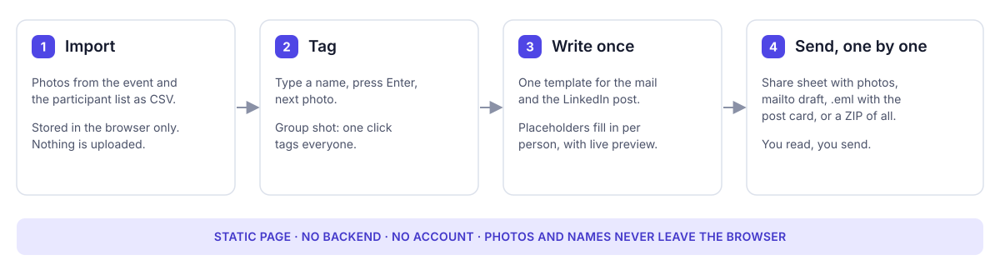
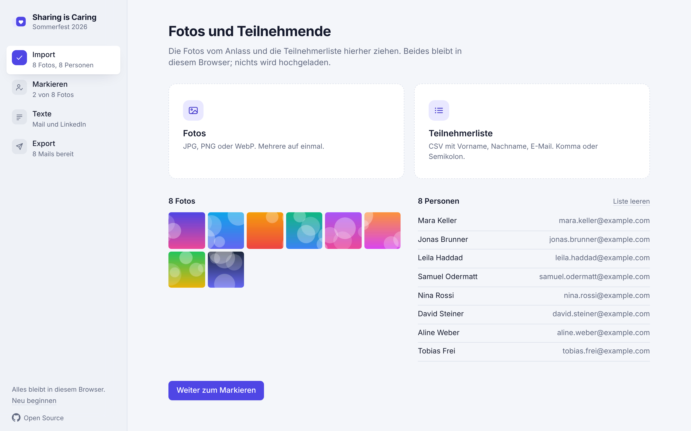
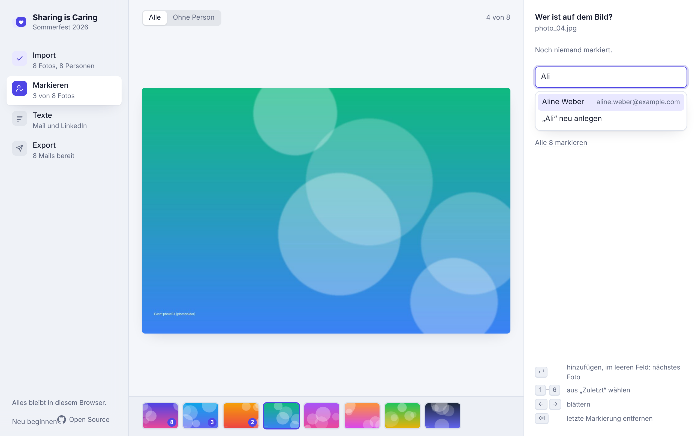
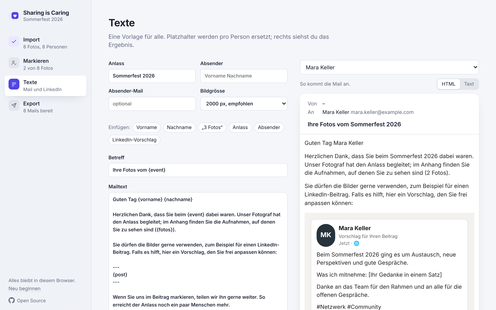
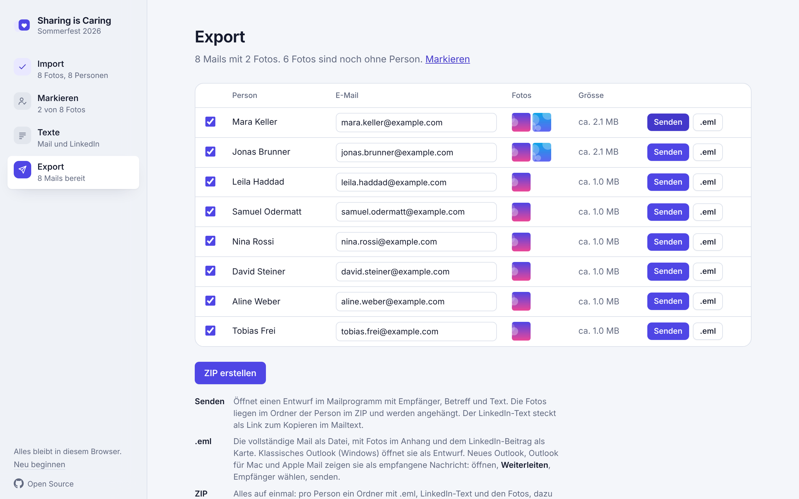

<!-- BEGIN public-repo-header -->
<div align="center">

# Sharing is Caring

**Event photos → the people in them → one mail each, with a LinkedIn post ready to use.**

<a href="https://github.com/blackmath88/sharing-is-caring/actions/workflows/ci.yml"></a>
<a href="https://github.com/blackmath88/sharing-is-caring/actions/workflows/deploy.yml"></a>
<a href="https://github.com/blackmath88/sharing-is-caring"></a>
<a href="https://github.com/blackmath88/sharing-is-caring/tree/main/docs"></a>
<a href="https://github.com/blackmath88/sharing-is-caring/blob/main/LICENSE"></a>
<a href="https://github.com/blackmath88/sharing-is-caring/commits/main"></a>

</div>
<!-- END public-repo-header -->

A small browser application for the step after an event: the photographer delivers a folder, and the people in the pictures should get theirs. Import the photos and the participant list, tag who is on which picture, write one template, and export one mail per person with their photos attached and a LinkedIn post suggestion they can copy with one click. Nothing is uploaded anywhere.

**[Open the app](https://blackmath88.github.io/sharing-is-caring/) · [Start](#start) · [What you can do](#what-you-can-do) · [Sending](#sending) · [Architecture](docs/ARCHITECTURE.md)**



*Flow, not an application screenshot. Screenshots with generated example data are further down.*

> **Sending stays manual by design.** The app prepares drafts; your own mail client sends them, one person at a time, after you have read each one. There is no mass mailing, no face recognition and no server.

## Start

Open **[the app](https://blackmath88.github.io/sharing-is-caring/)** and click **Mit Beispiel ausprobieren** on the first page. Eight generated photos and eight invented people load, and the four steps can be walked through in a minute. Real data stays in your browser's IndexedDB and localStorage; clear the site data and it is gone.

To run it locally, use **Node.js 22** and npm:

```bash
git clone https://github.com/blackmath88/sharing-is-caring.git
cd sharing-is-caring
npm ci
npm run dev
```

Open the local URL Vite prints (normally http://localhost:5173). The interface is in German.

## What you can do

| Task | Result |
|---|---|
| Import photos and a CSV list | Photos as thumbnails, people with name and address; the list parser accepts German or English headers, comma or semicolon |
| Tag a photo | Type a name, press Enter, next photo; a group shot is one click for everyone |
| Write one template | Mail text and LinkedIn post with placeholders, previewed per person as the real HTML mail |
| Send to one person | Share sheet with the photos, a mailto draft, or the full .eml with the post card |
| Export everything | A ZIP with one folder per person: .eml draft, LinkedIn text, resized photos, plus an overview CSV |
| Back up | People, tags and templates as one JSON file |

The recipient's mail is HTML: text, a LinkedIn-style card with their own photos as the post's media, and a **Text kopieren** button that opens a small page with a real copy-to-clipboard button. Plain-text clients get the same content as text.

## Sending

No mail client opens a draft with attachments from a file in every case, so the Export page offers three honest paths. Details and the client matrix are in [Sending](docs/SENDING.md).

| Path | What you get | Where |
|---|---|---|
| **Senden** | The system share sheet with the photos and the text; pick your mail app | Phones, Windows, Safari on Mac |
| **Senden**, fallback | A `mailto:` draft with recipient, subject and text; photos are in the person's ZIP folder | Everywhere else |
| **.eml** | The full mail with post card, previews and photos attached | Classic Outlook for Windows opens it as a draft; other clients show it as received: open, **Forward**, pick the recipient |

## Screenshots

Generated placeholder photos and invented names.

| Import | Tag |
|---|---|
|  |  |

| Template with live HTML preview | Export, per person or as ZIP |
|---|---|
|  |  |

<p align="center">
  <br>
  <em>What the recipient gets.</em>
</p>

<p align="center">
  <br>
  <em>Follows the system colour scheme.</em>
</p>

## Privacy

Nothing leaves the browser. Photos live in IndexedDB, names and templates in localStorage, and the app is a static page on GitHub Pages with no backend, no analytics and no third-party font host. The copy-text page carries the post in the URL fragment, which browsers never send to a server.

## Limits

- Tagging is manual. There is no face recognition, which keeps the tool simple and the photos offline.
- Mails above roughly 20 MB bounce at some servers; the Export page flags those rows. A smaller export size is one setting away.
- HEIC photos are not decoded by most browsers. Convert to JPEG first.
- Outlook renders mail with the Word engine: expect square avatar corners in the post card there.

## Verify a change

```bash
npm run check      # typecheck
npm run lint       # oxlint
npm test           # vitest: CSV parser, MIME builder, HTML builder, send module
npm run build      # static output in dist/
```

CI runs all four on every push. The deploy workflow builds on push to `main` and publishes to GitHub Pages; the app uses relative paths and hash routing, so it works under any repository name. See [Contributing](CONTRIBUTING.md) for the verification routine and the house rules.

## Find your next step

| Need | Read |
|---|---|
| How the pieces fit | [Architecture](docs/ARCHITECTURE.md) |
| What each mail client supports | [Sending](docs/SENDING.md) |
| Report a problem or propose a change | [Contributing](CONTRIBUTING.md) |

**Reuse:** [MIT](LICENSE). Demo photos are generated, demo people are invented; nothing in the repository depicts a real person.
