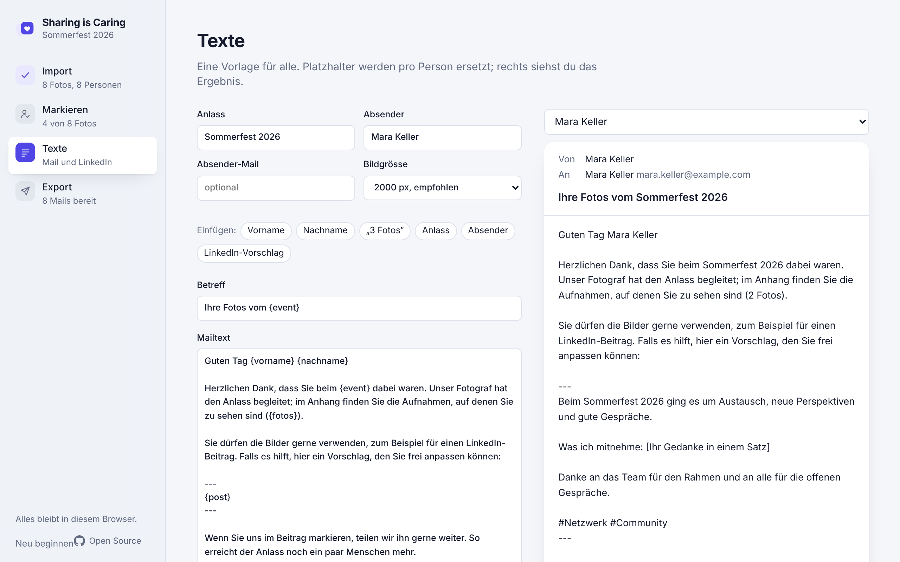
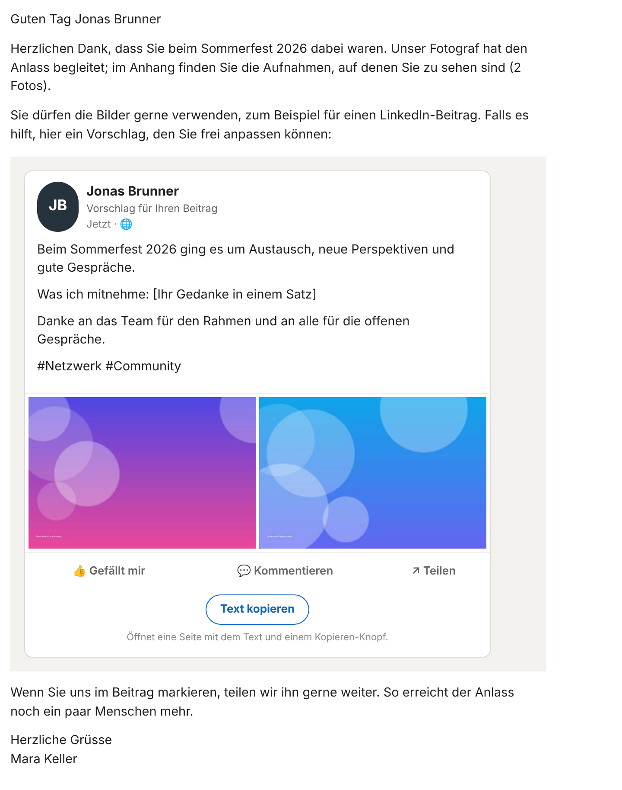
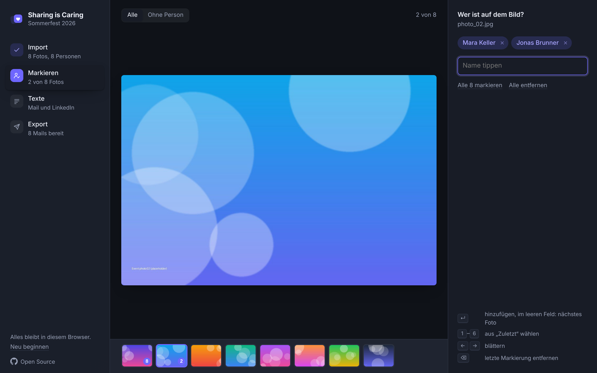

<p align="center">
  
</p>

<h1 align="center">Sharing is Caring</h1>

<p align="center">
  Send event photos to the people in them. Each person gets one mail with their pictures,<br>
  a ready-made LinkedIn post, and a one-click way to use it. Everything runs in the browser.
</p>

<p align="center">
  <a href="https://blackmath88.github.io/sharing-is-caring/"><b>Open the app</b></a> ·
  <a href="#how-it-works">How it works</a> ·
  <a href="#run-it-yourself">Run it yourself</a> ·
  <a href="LICENSE">MIT</a>
</p>

<p align="center">
  <a href="https://github.com/blackmath88/sharing-is-caring/actions/workflows/ci.yml"></a>
  <a href="https://github.com/blackmath88/sharing-is-caring/actions/workflows/deploy.yml"></a>
</p>

No account, no install. Open the app and click **"Mit Beispiel ausprobieren"** to walk through all four steps with generated photos and invented people.

---

## The problem

You host an event, a photographer takes a few hundred pictures, and then they sit in a folder.
The people who would love to post "I was there" never get their photos, or get a link to a gallery
of everyone and give up. Sending each person their own pictures by hand takes an afternoon.

## What this does

1. **Import** the photos and the participant list (CSV with first name, last name, email).
2. **Tag** who is on which picture. Type a name, press Enter, next photo. Group shot? One click tags everyone.
3. **Write one template** for the mail and the LinkedIn post. Placeholders fill in per person.
4. **Export** a ZIP with one folder per person, or one mail at a time. Each folder has an Outlook-ready
   draft (`.eml`) with the photos attached, the post as a text file, and the resized images.

Sending stays manual on purpose: one person at a time, you read, you send. No mass mailing, no automation you can't see.

### Sending

There is no universal way to open a draft with attachments in every mail client without an OAuth integration,
so the Export page offers three honest paths:

| Path | What you get | Where |
|---|---|---|
| **Senden** | The system share sheet with the photos and the text, pick your mail app | Phones, Windows, Safari on Mac |
| **Senden** (fallback) | A `mailto:` draft with recipient, subject and text; photos are in that person's ZIP folder | Everywhere else |
| **.eml** | The full mail: HTML post card, inline previews, photos attached | Classic Outlook on Windows opens it as a draft. New Outlook, Outlook for Mac and Apple Mail show it as a received message: open it, **Forward**, pick the recipient |

The mail itself is HTML. The LinkedIn suggestion is rendered as a post card with the person's own photos
as the media, and a **"Text kopieren"** button that opens a small page with a real copy-to-clipboard button.
Plain-text clients, the share sheet and the mailto draft get a text version with the same copy link.

## Privacy

Nothing leaves the browser. Photos live in IndexedDB, names and templates in localStorage, and the
app is a static page on GitHub Pages with no backend. The copy-text page carries the post in the URL
fragment, which browsers never send to a server. Delete your browser data and it's gone.

## Screenshots

| Import | Tag |
|---|---|
|  |  |

| Templates with live preview | Export, per person or as ZIP |
|---|---|
|  |  |

<p align="center">
  <br>
  <sub>What the recipient gets. Photos here are generated placeholders.</sub>
</p>

<p align="center">
  <br>
  <sub>Follows the system color scheme.</sub>
</p>

## How it works

- **No server.** Vite + React + TanStack Router with hash history, so it works from any path, including a GitHub Pages subfolder.
- **Images** are decoded once on import and stored as original, a 1600px view and a 320px thumbnail. Export resizes from the original to the size you pick (1600 / 2000 / 2560px).
- **The `.eml` trick.** Each draft is a standard RFC 822 message with the header `X-Unsent: 1`. Outlook on Windows treats that as "open as a draft, not as received mail". The structure is `multipart/mixed` → `multipart/related` → `multipart/alternative`, so the mail carries plain text, HTML, inline thumbnails via `cid:` and the full-size JPEGs as attachments.
- **The post card** is table-based HTML with inline styles, because Outlook renders mail with the Word engine. Expect square avatar corners there.
- **The copy page** (`#/post?t=…`) decodes the post from the URL and offers one button. Mail clients strip scripts, so this is the only way a "copy" button in a mail can work.
- **Participant list.** Any CSV with columns like `Vorname`, `Nachname`, `E-Mail` (or `Name` as full name). Comma or semicolon, UTF-8 or Windows-1252. Column matching is fuzzy, English headers work too. Excel files: save as CSV first.
- **Backup.** People, tags and templates export as one JSON file. Photos are not included, re-import them with the same file names.

The UI is in German. The code and this README are in English.

## Run it yourself

```bash
npm ci
npm run dev        # http://localhost:5173
npm run build      # static output in dist/
npm run check      # typecheck
npm run lint       # oxlint
npm test           # vitest: CSV parser, MIME builder, HTML builder
```

CI runs all four on every push. Image resizing for the export runs in a Web Worker pool, so the UI stays responsive and the export can be cancelled.

### Deploy to GitHub Pages

Fork or push the repo, then in **Settings → Pages** set **Source** to **GitHub Actions**.
The workflow in `.github/workflows/deploy.yml` builds and deploys on every push to `main`.
Because the app uses relative paths and hash routing, it works under any repository name without configuration.

## Limitations

- Outlook for Windows opens `.eml` as an unsent draft. Apple Mail and others show it as a received message; you can still forward it or copy the content.
- No face recognition. Tagging is manual by design, it keeps the tool simple and your photos offline. Group photos are one click.
- Mails above roughly 20 MB bounce at some mail servers. Pick a smaller export size for people with many photos.
- HEIC photos are not decoded by most browsers. Convert to JPEG first.

## Repository layout

```
src/
  main.tsx          routes: the four steps inside the app shell, plus the standalone copy page
  store.ts          zustand store, persisted to localStorage
  db.ts             IndexedDB blobs and image resizing
  csv.ts            participant list parsing
  templates.ts      default texts and placeholder filling
  html.ts           HTML mail body and the LinkedIn-style post card
  eml.ts            MIME assembly for the .eml drafts
  exporter.ts       builds one mail or the whole ZIP
  icons.tsx         icon set and logo
  pages/            Import, Tag, Templates, Export, Post
```

## License

[MIT](LICENSE)
